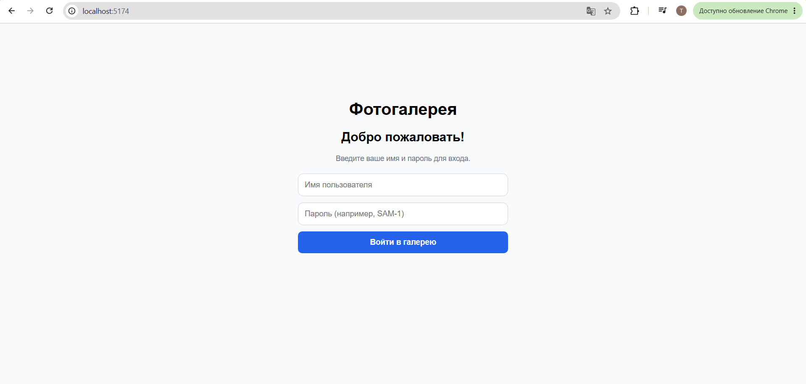

# Kept — фотогалерея

Мой учебный проект. Веб-приложение для хранения фотографий: после входа в аккаунт пользователь загружает фото и видит свою галерею. Файлы лежат в публичном хранилище, поэтому любое фото можно открыть и отправить другому человеку по прямой ссылке.

Экран входа в галерею:



## Над чем я работала

Фронтенд взят из открытого проекта: [оригинальный репозиторий](https://github.com/zinagkouma/Private-Image-Gallery-App). Моя часть:

- настроила бэкенд в Supabase: вход в аккаунт, база данных, хранилище для фото
- написала автотесты на Playwright и pytest
- прогнала нагрузочные тесты в k6
- настроила мониторинг в Oracle Cloud с алертами на почту
- завела CI на GitHub Actions и собрала Docker-образ

## Подробнее

- [Тестирование](docs/TESTING.md): что и как я проверяла, с цифрами
- [Мониторинг в облаке](docs/MONITORING.md): алармы в OCI и как я проверяла, что они срабатывают
- [Схема базы данных](supabase/schema.sql): таблицы, права доступа и хранилище

## Коротко о результатах

- UI-тесты: прошли все 5 из 5
- Stress-тест (только фронтенд), до 150 пользователей: ни одной ошибки, p95 около 49 мс
- Spike-тест (только фронтенд), до 120 пользователей: ни одной ошибки, p95 около 65 мс
- Алерт в OCI: я специально нагрузила процессор, аларм сработал и на почту пришло письмо

## Как я сделала бэкенд

Бэкенд на Supabase:

- Таблица `photos` защищена RLS: пользователь видит и добавляет в галерею только свои записи.
- Сами файлы лежат в публичном bucket `event-photos`. Загружать их могут только вошедшие пользователи, а открыть файл по прямой ссылке может любой, у кого она есть. 
- Таблица `profiles` хранит имя и код входа.

Чтобы поднять такой же бэкенд у себя:

1. Создать проект на [supabase.com](https://supabase.com)
2. Открыть SQL Editor и выполнить `supabase/schema.sql` (он создаёт таблицы, права и bucket `event-photos`)
3. Скопировать `.env.example` в `.env` и вписать свои URL и ключ проекта

Ключи в репозитории я не храню, `.env` лежит в `.gitignore`.

## Как запустить

```bash
npm install
npm run dev
```

Откроется на `http://localhost:5173`.

Через Docker:

```bash
docker build -t kept .
docker run -p 8080:80 kept
```

Тесты:

```bash
pytest test_sam.py -v
```

## Из чего сделано

React и Vite, Supabase, Python (pytest, Playwright), k6, Docker и nginx, GitHub Actions, Kubernetes в Oracle Cloud.

## Ограничения и планы

- Bucket `event-photos` публичный. Файлы загружают только вошедшие пользователи, но по прямой ссылке их открывает любой. Фронтенд работает через публичные ссылки, поэтому без правок кода bucket не закрыть.
- Вход построен на таблице `profiles`. Код хранится открытым текстом, RLS на этой таблице выключен.
- Нагрузочные тесты шли только на фронтенд, Supabase в них не входил.
- Порог алерта по CPU занижен, чтобы он сработал на показе.
- В планах деплой на Vercel и запуск UI-тестов в CI.
