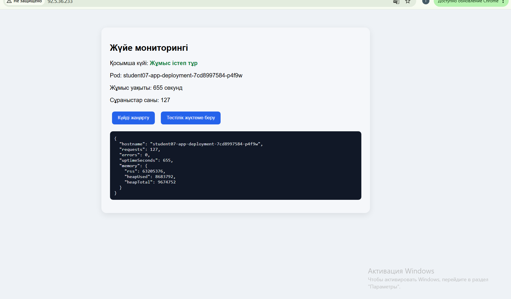
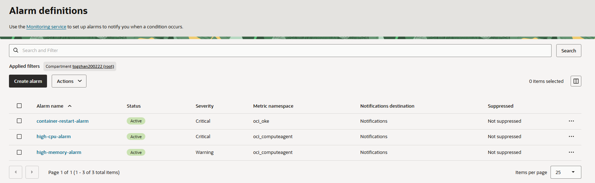
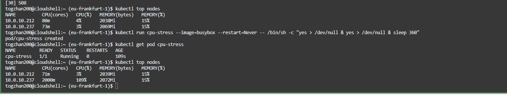

# Мониторинг в облаке

Здесь описано, как я настроила наблюдение за кластером Kubernetes (OKE) в Oracle Cloud: что именно мониторится, как настроен аларм по CPU, как я проверила, что он срабатывает, и как это видно на общем дашборде.

## Что мониторится

Мониторится кластер OKE из двух узлов и приложение, которое в нём работает. По кластеру я смотрю четыре показателя: загрузку CPU, использование памяти, входящий и исходящий сетевой трафик, состояние кластера.

Само приложение тоже отдаёт страницу с текущим состоянием: статус, имя пода, время работы в секундах, число обработанных запросов, число ошибок и использование памяти процессом. Приложение работает в кластере и доступно по внешнему IP-адресу. Интерфейс страницы на казахском: «Қосымша күйі» — состояние приложения, «Жұмыс уақыты» — время работы, «Сұраныстар саны» — число запросов.

<div align="center">
  
  <br>
  <i>Страница состояния приложения, работающего в кластере</i>
</div>

<br>

## Аларм на CPU

В OCI Monitoring настроен аларм на загрузку CPU. Когда метрика превышает порог, аларм переходит в состояние Firing и через сервис Notifications отправляет письмо на почту. Когда нагрузка падает, аларм возвращается в состояние OK.

<div align="center">
  
  <br>
  <i>Список алармов в OCI Monitoring</i>
</div>

<br>

## Нагрузка на CPU

Чтобы проверить мониторинг, я искусственно нагрузила процессор. 

Команды выполнялись в OCI Cloud Shell. Я запустила в кластере отдельный под `cpu-stress` на образе `busybox`:

```bash
kubectl run cpu-stress --image=busybox --restart=Never -- /bin/sh -c "yes > /dev/null & yes > /dev/null & sleep 360"
```

До запуска на обоих узлах загрузка CPU была 3–4%. Через пару минут после запуска на одном узле она достигла 2000m (109%), на втором осталась около 3%. Память не изменилась и осталась на уровне 15%.

<div align="center">
  
  <br>
  <i>Искусственная нагрузка на CPU в кластере (kubectl top nodes до и после запуска)</i>
</div>

<br>

## Срабатывание аларма

Во время нагрузки аларм перешёл в состояние Firing, и на почту пришло уведомление. После окончания нагрузки аларм вернулся в состояние OK.

<div align="center">
  
  <br>
  <i>Аларм сработал (Firing)</i>
</div>

<br>

<div align="center">
  
  <br>
  <i>Нагрузка снята, аларм вернулся в состояние OK</i>
</div>

<br>

## Отражение на дашборде

Нагрузка видна и на общем дашборде OCI. На графике CPU Utilization виден пик примерно до 50%, который держится несколько минут и затем возвращается к исходному уровню (запуск 23 ноября, около 18:45). Память и сетевой трафик при этом почти не изменились.

<div align="center">
  
  <br>
  <i>Дашборд в Oracle Cloud: CPU, память, сеть, состояние кластера</i>
</div>

<br>

## Ограничения

* Порог аларма по CPU я поставила совсем низкий, чтобы он точно сработал на показе. В реальной системе порог был бы выше, иначе уведомления приходили бы слишком часто.
* Облачные метрики показывают состояние ресурсов кластера. Проверки доступности приложения снаружи (запрос по адресу каждые N секунд) у меня нет.
