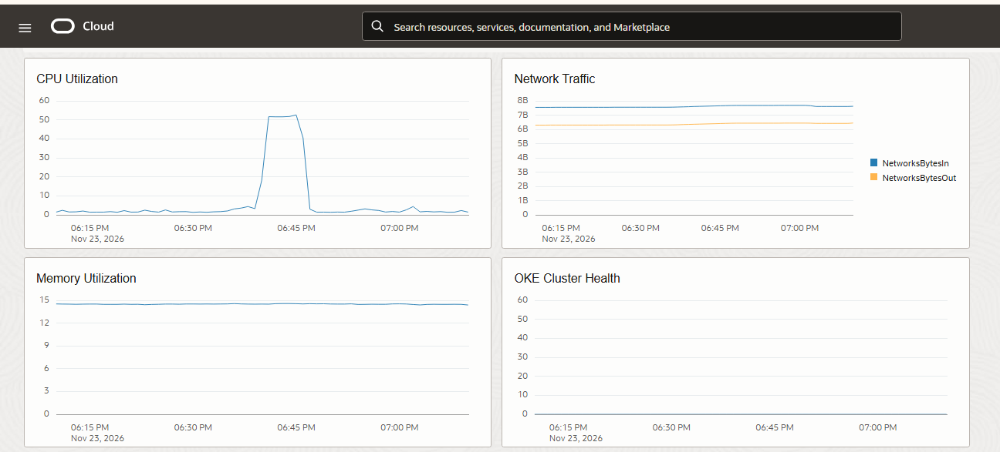
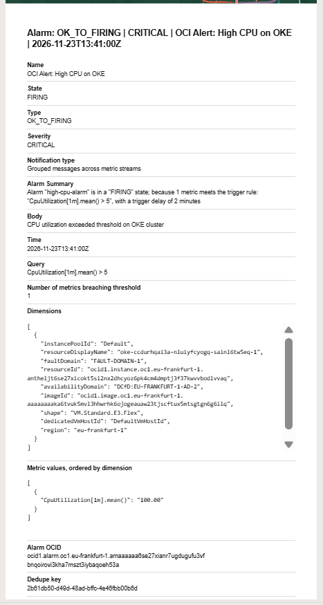
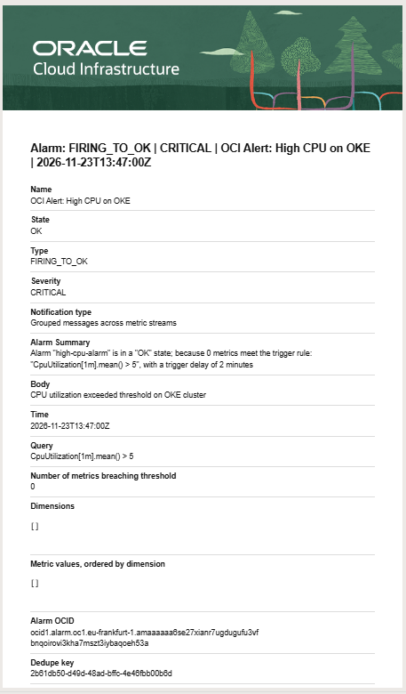

# Мониторинг в облаке

Здесь описано, как я настроила наблюдение за приложением, которое работает в кластере Kubernetes (OKE) в Oracle Cloud: какие метрики смотрю, как настроен аларм по CPU и как я проверила, что он срабатывает.

## Что настроено

- Дашборд в OCI с метриками кластера: загрузка CPU, память, сетевой трафик
- Аларм на загрузку CPU с уведомлением на почту
- Страница состояния самого приложения (имя пода, время работы, число запросов, память)

## Дашборд

На дашборде собраны основные метрики кластера: загрузка CPU, использование памяти, входящий и исходящий сетевой трафик, состояние кластера OKE.

  
   
  <i>Дашборд в Oracle Cloud: CPU, память, сеть, состояние кластера</i>

 

## Страница состояния приложения

Само приложение отдаёт страницу с текущим состоянием: статус, имя пода, время работы в секундах, число обработанных запросов и использование памяти процессом. Приложение работает в кластере и доступно по внешнему IP-адресу.

  
   
  <i>Страница состояния приложения, работающего в кластере</i>

 

## Проверка нагрузкой

Чтобы увидеть, как метрики реагируют на нагрузку, я искусственно нагрузила процессор в кластере. На дашборде видно, что загрузка CPU выросла примерно до 50% и после окончания нагрузки вернулась к исходному уровню (23 ноября, около 18:45). Память и сетевой трафик при этом почти не изменились.

  
   
  <i>Искусственная нагрузка на CPU в кластере</i>

 

## Аларм на CPU

В OCI Monitoring настроен аларм на загрузку CPU. Когда метрика превышает порог, аларм переходит в состояние Firing и через сервис Notifications отправляет письмо на почту. Когда нагрузка падает, аларм возвращается в состояние OK.

  
   
  <i>Список алармов в OCI Monitoring</i>

 

### Как я проверила, что аларм работает

Я снова создала нагрузку на процессор. Аларм перешёл в состояние Firing и на почту пришло уведомление. После снятия нагрузки аларм вернулся в состояние OK.

  
   
  <i>Аларм сработал (Firing)</i>

 

  
   
  <i>Нагрузка снята, аларм вернулся в состояние OK</i>

 
## Ограничения

* Порог аларма по CPU я поставила совсем низкий, чтобы он точно сработал на показе. В реальной системе порог был бы выше, иначе уведомления приходили бы слишком часто.
* Облачные метрики показывают состояние ресурсов кластера. Проверки доступности приложения снаружи (запрос по адресу каждые N секунд) у меня нет.
* Аларм настроен только на CPU, на память и сеть алармов нет.
