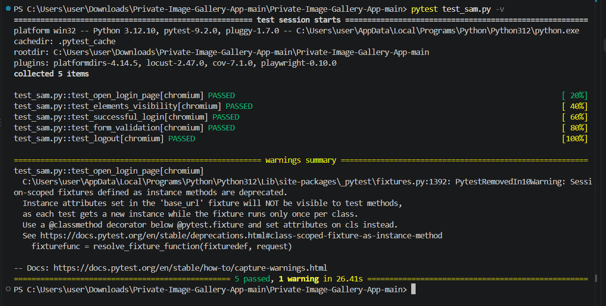
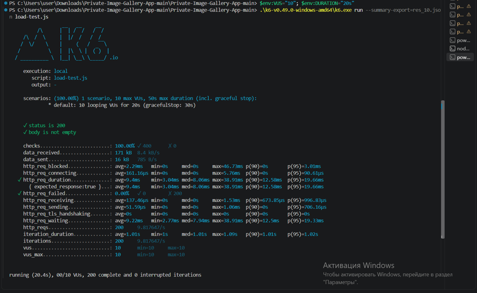
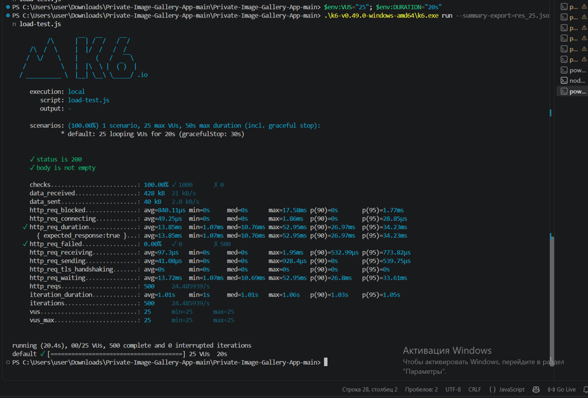
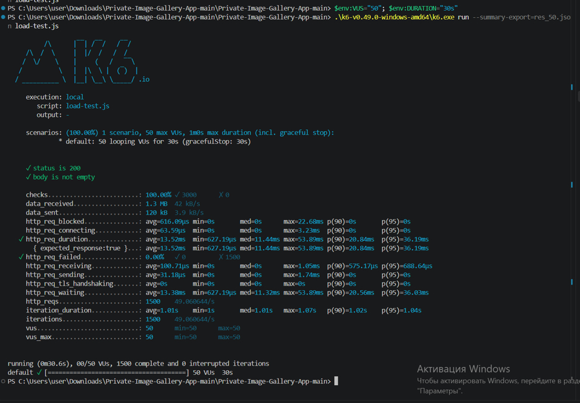
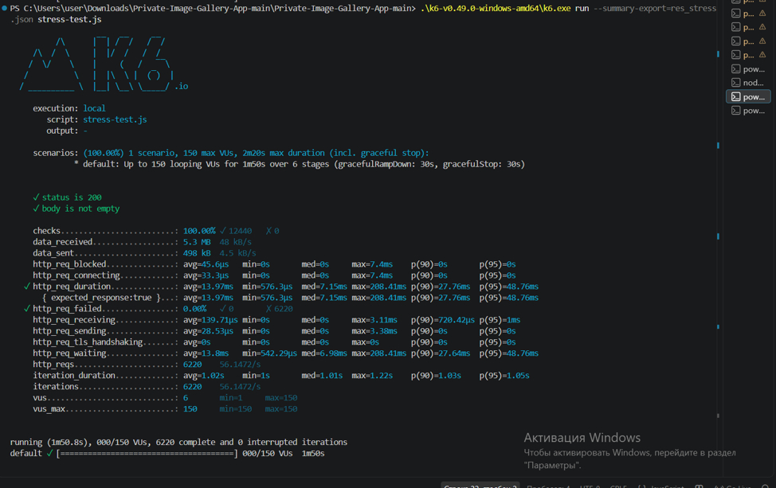
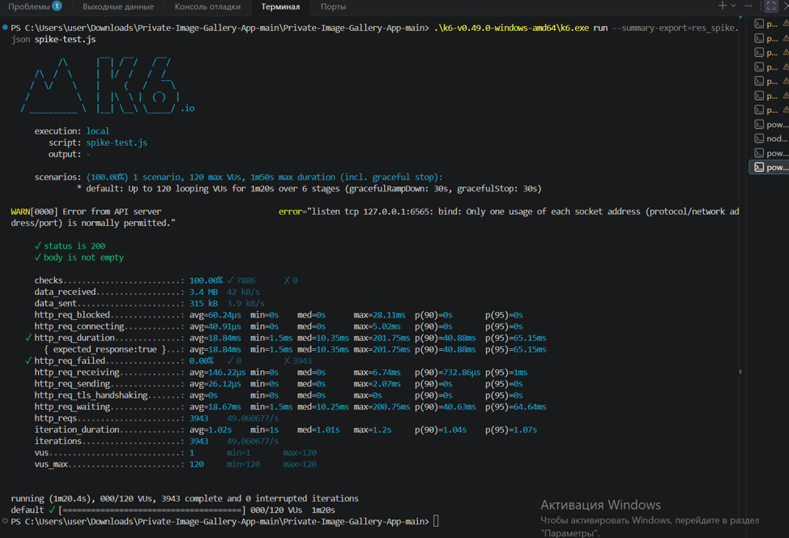
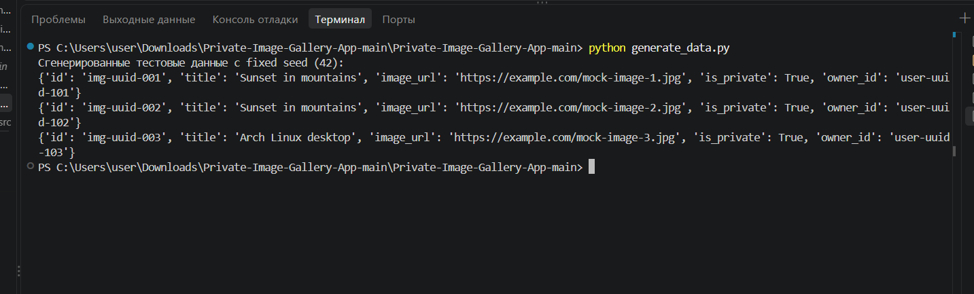

# Тестирование

Здесь описано, как я проверяла приложение: интерфейс тестировала автотестами, нагрузку замеряла в k6.

Тесты шли на локальном dev-сервере (`http://localhost:5173`). Запросы к Supabase в нагрузочные сценарии не входили, поэтому цифры относятся к фронтенду.

## Инструменты

- Playwright и pytest для UI-тестов
- k6 для нагрузочных тестов
- Python для генерации тестовых данных

## UI-тесты

Пять автотестов в `tests/test_sam.py` прогоняют основные сценарии в браузере Chromium.

| Тест | Что проверяет |
|---|---|
| `test_open_login_page` | страница входа открывается |
| `test_elements_visibility` | нужные элементы видны на странице |
| `test_successful_login` | вход с верными данными работает |
| `test_form_validation` | форма не принимает неверный ввод |
| `test_logout` | выход из аккаунта работает |

Прошли все 5 тестов за 26.41 с. Pytest выдал одно предупреждение о способе объявления фикстуры `base_url`, на результат оно не влияет.

Перед запуском приложение должно работать (`npm run dev`), иначе тесты падают.

```bash
pytest tests/test_sam.py -v

```
<div align="center">
  
  <br>
  <i>Результат прохождения автотестов pytest</i>
</div>

<br>

## Нагрузочные тесты

В каждом сценарии проверялось, что ответ приходит со статусом 200 и тело не пустое. Во всех сценариях проверки прошли на 100%, запросов с ошибками не было.

### Load

Постоянная нагрузка, три уровня.

| Пользователи (VU) | Длительность | Запросов | Запросов в секунду | Среднее | Медиана | p95 | Максимум | Ошибки |
| --- | --- | --- | --- | --- | --- | --- | --- | --- |
| 10 | 20 с | 200 | 9.82 | 9.40 мс | 8.06 мс | 19.66 мс | 38.91 мс | 0% |
| 25 | 20 с | 500 | 24.49 | 13.85 мс | 10.76 мс | 34.23 мс | 52.95 мс | 0% |
| 50 | 30 с | 1500 | 49.06 | 13.52 мс | 11.44 мс | 36.19 мс | 53.89 мс | 0% |

<div align="center">
  
  <br>
  <i>Нагрузочный тест k6: 10 виртуальных пользователей (VU)</i>
</div>

<br>

<div align="center">
  
  <br>
  <i>Нагрузочный тест k6: 25 виртуальных пользователей (VU)</i>
</div>

<br>

<div align="center">
  
  <br>
  <i>Нагрузочный тест k6: 50 виртуальных пользователей (VU)</i>
</div>
### Stress и spike

Stress поднимает нагрузку ступенями до 150 пользователей. Spike резко увеличивает нагрузку, максимум в нём 120 пользователей.

| Сценарий | Пользователи (VU) | Длительность | Запросов | Запросов в секунду | Среднее | Медиана | p95 | Максимум | Ошибки |
| --- | --- | --- | --- | --- | --- | --- | --- | --- | --- |
| Stress | 150 | 1 мин 50 с | 6220 | 56.1 | 13.97 мс | 7.15 мс | 48.76 мс | 208.41 мс | 0% |
| Spike | 120 | 1 мин 20 с | 3943 | 49.1 | 18.84 мс | 10.35 мс | 65.15 мс | 201.75 мс | 0% |

<div align="center">
  
  <br>
  <i>Нагрузочный тест k6: сценарий Stress (до 150 VU)</i>
</div>

<br>

<div align="center">
  
  <br>
  <i>Нагрузочный тест k6: сценарий Spike (до 120 VU)</i>
</div>

<br>

Запуск на примере stress-теста:

```powershell
.\tests\k6-v0.49.0-windows-amd64\k6.exe run --summary-export=reports/res_stress.json tests/stress-test.js

```

Скрипты нагрузочных тестов находятся в каталоге `tests/` (`load-test.js`, `stress-test.js`, `spike-test.js`), а сводки запусков сохраняются в `reports/` (`res_*.json`).

### Что видно по результатам

* Число запросов в секунду растёт вместе с числом пользователей, потому что каждый делает примерно один запрос в секунду.
* От 25 до 50 пользователей среднее время почти не изменилось (13.85 и 13.52 мс), p95 вырос с 34 до 36 мс.
* На stress и spike максимум времени ответа около 200 мс, p95 не выше 65 мс.
* Предел фронтенда в этих тестах не достигнут.

## Тестовые данные

`generate_data.py` создаёт тестовые данные с фиксированным seed (`random.seed(42)`), поэтому при каждом запуске результат одинаковый.

```bash
python tests/generate_data.py

```

<br>
<div align="center">
  
  <br>
  <i>Генерация тестовых данных скриптом tests/generate_data.py</i>
</div>

<br>

## Ограничения

* Нагрузка шла на фронтенд, Supabase в тестах не участвовал.
* Тесты запускались на локальной машине, в облаке нагрузку не проверяла.

